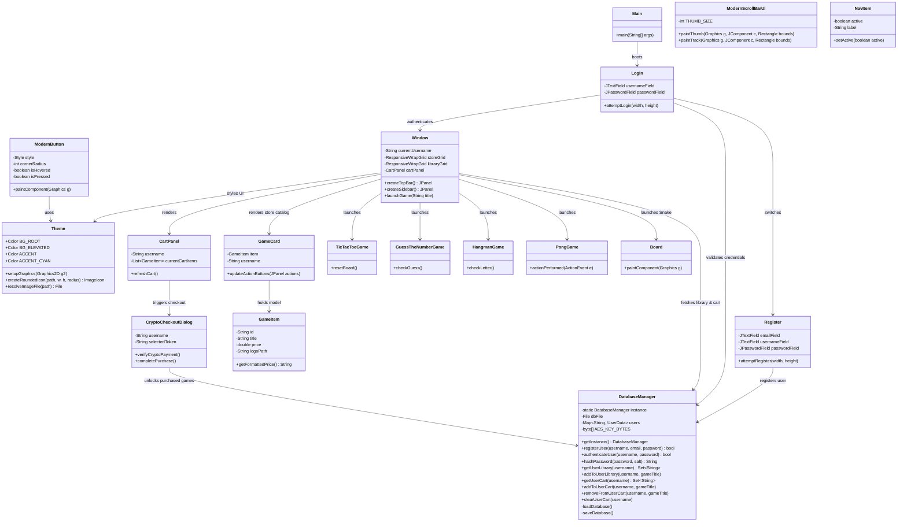
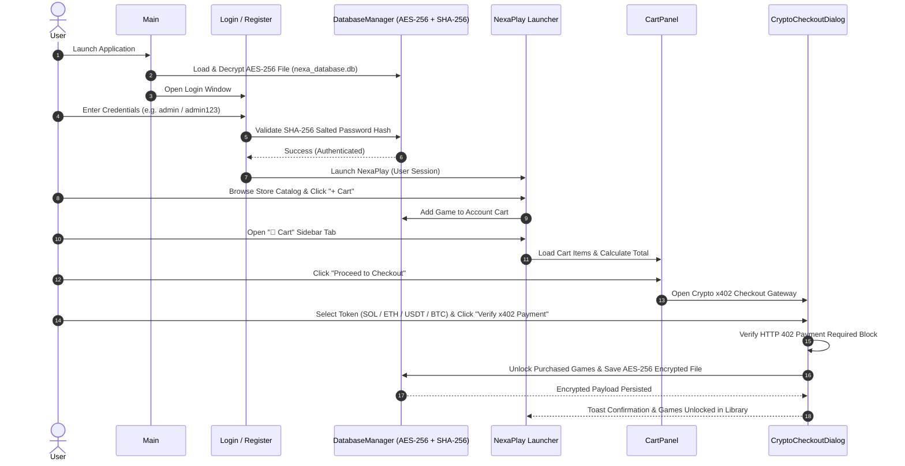

# 🎮 NexaPlay 3.0 — Modern Desktop Gaming Launcher & Store

[](https://adoptium.net/)
[]()
[]()
[]()
[]()

**NexaPlay** is a state-of-the-art desktop gaming launcher, store, and game platform built in **Java 26** and **Pure Java Swing**. Inspired by modern gaming client platforms such as Steam, Epic Games Store, and GOG Galaxy, NexaPlay features custom antialiased graphics rendering, Generational ZGC zero-stutter performance, dark glassmorphism aesthetics, a Store Cart and **Crypto x402 Web3 Payment Gateway**, an **AES-256 Encrypted Persistent Database Engine**, and 5 overhauled built-in mini-games.

---

## 🌟 Key Features & Architecture

### ⚡ 1. Java 26 Platform Performance
- **Generational ZGC**: Sub-millisecond GC pause times (<1ms) ensuring smooth 60 FPS repaints across all games and animations.
- **Compact Object Headers**: Up to 50% lower heap memory usage when managing store cards and game graphics assets.
- **Modern Language Features**: Flexible constructor bodies, pattern matching, and enhanced vector graphics interop.

---

### 🔒 2. Enterprise Database Security (`DatabaseManager.java`)
- **SHA-256 Cryptographic Salted Password Hashing**: Passwords are **never stored in plain text**. Each registered account receives a unique 128-bit random salt (`SecureRandom`) and SHA-256 cryptographic hash.
- **AES-256 CBC Binary Database Encryption**: All database payloads (`nexa_database.db`) are encrypted using 128-bit/256-bit AES encryption with random Initialization Vectors (IV). Opening the database file in text editors displays unreadable binary cipher payload.
- **Generic Pre-Configured Test Accounts**:
  | Username | Email | Password | Role |
  | :--- | :--- | :--- | :--- |
  | `admin` | `admin@nexaplay.io` | `admin123` | Administrator |
  | `demo` | `demo@nexaplay.io` | `demo` | Demo User |
  | `guest` | `guest@nexaplay.io` | `guest123` | Guest User |

---

### 🎨 3. Pure Java Custom Design Engine
- **Antialiased Graphics**: Global 2D rendering hints (`RenderingHints`) for smooth curves, text, and vector graphics.
- **Modern Dark Aesthetics**: Futuristic dark charcoal/navy palette (`#0B0E14`), electric indigo (`#6366F1`), cyan (`#06B6D4`), and emerald green accents.
- **Custom Components**:
  - `ModernButton`: Rounded animated buttons (`12px` arc) with hover/press color transitions.
  - `NavItem`: Sidebar navigation tab with glowing active indicator bars.
  - `ModernScrollBarUI`: Minimalist dark scrollbars replacing Windows native light-gray scrollbars.
  - `ResponsiveWrapGrid`: Auto-calculated dynamic grid centering game cards.
  - `ToastManager`: Floating non-blocking notification overlays anchored to `JLayeredPane`.

---

### 🛒 4. Store Cart & Crypto x402 Payment System
- **Game Catalog Pricing**: Free games (`$0.00`) and paid titles (`$4.99`, `$9.99`, `$14.99`).
- **Store Cart (`CartPanel.java`)**: Cart tab (`🛒 Cart (X)`) with live item counter badge, subtotal calculations, and item removal.
- **Crypto x402 Web3 Gateway (`CryptoCheckoutDialog.java`)**: Interactive checkout modal implementing the **HTTP 402 Payment Required** Web3 protocol. Supports **SOL (Solana)**, **ETH (Ethereum)**, **USDT (Tether)**, and **BTC (Bitcoin)** with real-time crypto price conversion, wallet copy, and transaction verification.

---

### 🕹️ 5. 5 Overhauled Built-In Games
1. **Tic Tac Toe (`TicTacToeGame.java`)**: Interactive 3x3 grid with player turn indicators, custom symbols ('X' / 'O'), and restart logic.
2. **Snake (`Board.java`)**: Dark grid arcade game with smooth snake movement, live score tracking, and restart overlays.
3. **Pong (`PongGame.java`)**: 2-player neon arcade pong with paddle controls (`W/S` & `Up/Down`), glowing ball physics, and scoreboard.
4. **Hangman (`HangmanGame.java`)**: Custom antialiased vector canvas drawing gallows & stick figure, spaced letter slots, and mistake counters.
5. **Guess The Number (`GuessTheNumberGame.java`)**: Brain challenge game with attempt tracking (`5/5`), feedback log (`Too High ⬇️`, `Too Low ⬆️`), and play again actions.

---

## 📐 Unified System UML Architecture

### 1. Master System Class Diagram



---

### 2. User Authentication & Crypto x402 Checkout Sequence Diagram



---

## 📁 Repository Structure

```
NexaPlay Project 2.0/
├── .gitignore               # Ignored build binaries and temporary logs
├── README.md                # Project documentation and architecture UML
├── App/                     # Source Code Root
│   ├── Main.java            # Unified Application Entry Point
│   ├── Login.java           # Centered Glassmorphic Sign In Window
│   ├── Register.java        # Account Registration Window
│   ├── NexaPlay.java        # Main Launcher & Store Shell Window
│   ├── Theme.java           # Design System Tokens & Antialiasing Helpers
│   ├── ModernButton.java    # Custom Rounded Animated Button Component
│   ├── ModernScrollBarUI.java # Minimalist Dark Scrollbar UI
│   ├── NavItem.java         # Sidebar Tab Navigation Item
│   ├── GameCard.java        # Store Game Card with Hover Elevation Lift
│   ├── GameItem.java        # Store Catalog Game Item Data Model
│   ├── CartPanel.java       # E-Commerce Cart View & Order Summary
│   ├── CryptoCheckoutDialog.java # Web3 HTTP 402 Payment Required Dialog
│   ├── DatabaseManager.java # AES-256 Encrypted & SHA-256 Hashed Database
│   ├── ToastManager.java    # Floating Non-Blocking Toast Overlays
│   ├── ResponsiveWrapGrid.java # Auto-Calculated Responsive Grid Layout
│   ├── TicTacToeGame.java   # Overhauled Tic Tac Toe Game
│   ├── GuessTheNumberGame.java # Overhauled Guess The Number Game
│   ├── HangmanGame.java     # Overhauled Vector Canvas Hangman Game
│   ├── PongGame.java        # Overhauled Arcade Neon Pong Game
│   └── Snake/               # Snake Game Module
│       ├── code/
│       │   ├── Snake.java   # Snake Game Frame
│       │   └── Board.java   # Overhauled Dark Grid Snake Engine
│       └── resources/       # Snake Graphics Assets
└── bin/                     # Compiled JDK 26 Class Files
```

---

## 🛠️ Build & Running Instructions

### Requirements
- **Java JDK 26** or later (Eclipse Adoptium Temurin JDK 26).

### 1. Compile the Project
Open terminal in project root directory and compile all Java sources into `./bin`:
```bash
# Windows PowerShell / Command Prompt
& "C:\Program Files\Eclipse Adoptium\jdk-26.0.1.8-hotspot\bin\javac.exe" -d ./bin App/*.java App/Snake/code/*.java
```

### 2. Launch the Application
Run `Main` class to start the unified app:
```bash
# Windows PowerShell
& "C:\Program Files\Eclipse Adoptium\jdk-26.0.1.8-hotspot\bin\java.exe" -cp ./bin Main
```

*(Sign in with default credentials `admin` / `admin123`, `demo` / `demo`, `guest` / `guest123`, or register a new account!)*

---

## 📜 License
Distributed under the **MIT License**. See `LICENSE` for details.
